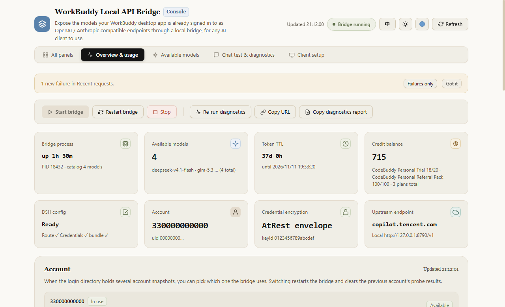
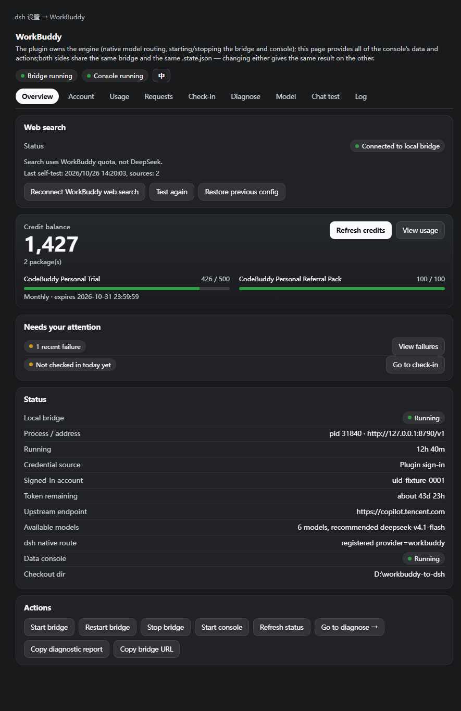

# WorkBuddy Local API Bridge

Expose WorkBuddy's model capabilities (DeepSeek / GLM / Kimi / MiniMax …) through a
local bridge as **OpenAI-compatible**, **Anthropic-compatible** and **OpenAI Responses**
APIs — so **Claude Code**, **Codex**, **opencode**, **Cursor**, **Trae**,
**Cherry Studio**, **NextChat**, **LobeChat**, **Open WebUI** or any client with a
custom Base URL can use them directly.

Two credential sources: the **WorkBuddy desktop app** you are already logged in to, or
**"Plugin sign-in" inside the dsh plugin** — **the desktop app is optional**; a one-time
browser authorization is enough (credentials are kept encrypted by the plugin).

Also included: a web console (status / start-stop / diagnostics / model registration /
usage / health check / chat test) — **bilingual (Chinese / English, switchable in the
top-right corner, remembered locally)** — and an optional **DeepSeek Harness (dsh)
native plugin**.

> **In one line**: WorkBuddy quota → local API → any AI client you like.

<picture>
  <source media="(prefers-color-scheme: dark)" srcset="docs/console-hero-en-dark.png">
  
</picture>

> 🌏 **English summary only.** The full documentation is in Chinese
> ([README.md](README.md), [docs/](docs/)); both cover the same system.
> The console itself has a complete English UI — the `EN` toggle sits next to the
> theme switch.

## For DSH users: one install, everything included

Use WorkBuddy models in **DeepSeek Harness (dsh)** and this repo gives you the complete
set: a **native dsh plugin + local API bridge + web console**. One command installs the
plugin; after restarting dsh, WorkBuddy models appear in the model picker — and everything
else lives in the same plugin: model management (enable / disable, health checks with cost
multipliers), account switching, credit & usage tracking with trends and CSV export,
per-request details (failures highlighted with upstream error codes), 8-point environment
diagnostics, multi-turn chat test, and automatic daily check-in. The bridge also speaks
OpenAI / Anthropic / Responses, so Claude Code, Codex, opencode, Cherry Studio and other
clients can connect directly.

```sh
dsh plugin --profile desktop add github:Ianzhyh/workbuddy-to-dsh
```

**One-click ready:** install the plugin → open **Settings → WorkBuddy → Account → Sign in**
(the browser opens automatically) → pick a WorkBuddy model. No desktop app, API key,
Base URL, token, port or environment variable is required. If the desktop app is already
signed in, its login is reused and step 2 is unnecessary. The China / Global region is
pre-selected from the existing account or desktop domain, and the model picker refreshes
after sign-in, account switches or bridge restarts — no extra dsh restart.
Model names carry their credit multiplier (`DeepSeek-V4.1-Flash · ×0.11`; free models
are marked too). The chat header keeps a click-to-refresh credit pill (hover for today's
spend and the last call) and turns into a sign-in entry when an existing conversation
loses its credentials. An empty chat offers a one-click "Connect WorkBuddy" button, and
the latest turn shows its credit cost — matched against the turn's tokens and the local
request ledger when the host exposes them, otherwise a clearly-labelled estimate.

#### In the chat view

| Where | What you see | Notes |
|---|---|---|
| Model name | `DeepSeek-V4.1-Flash · ×0.11` / `· Free` | The multiplier comes from the model catalog; no need to open details |
| Chat header | `Credits 715` | Hover for package remaining, today's spend and the last call; turns amber at ≤30%, red at ≤10%; click to refresh. A failed read keeps the last balance with an error mark; with an existing conversation and no valid sign-in, this seat becomes the sign-in entry |
| End of the latest turn | `This turn: 0.03 credits` | Matched against the turn's tokens and the local request ledger when available; falls back to the latest completed request (marked `≈`, tooltip explains) on older hosts or when no match is provable |
| Empty chat | `Connect WorkBuddy` | Starts browser authorization without opening Settings; the model picker refreshes automatically |

`×0.11` is a **credit multiplier**, not a CNY price; free models are labelled as such.

## ⚠️ Read this first (disclaimer & boundaries)

- **Unofficial path.** This relies on WorkBuddy's undocumented upstream protocol and
  credential formats (plugin sign-in does **not** need the desktop app, but still uses
  an unofficial device-code flow). The upstream may change protocols or tighten risk
  control at any time (it already happened) — **no availability or compatibility guarantee**.
- **Only drives YOUR account.** It uses the desktop account logged in on **your own
  machine**, or the plugin account you explicitly authorized, and consumes that
  account's quota. **Do not** use it for multi-account pooling, proxying for others,
  or any resale/hosting service.
- **Check WorkBuddy's Terms of Service** before use; if they disallow this, don't use it.
- **No warranty.** Provided "as is" under MIT. Use a real API contract for anything
  long-term or commercial.
- Sharing the repo link, writing tutorials and sending PRs are welcome. **Do not**
  repackage it for sale, bundle it with payment, or collect anyone's credentials in
  its name.

## How it differs from similar tools

- **Opposite direction to claude-code-router (CCR)**: CCR injects other providers'
  APIs *into* Claude Code; this project exports *from* WorkBuddy to standard APIs.
  Complementary, not competing.
- **vs the WorkBuddy2API cluster (20+ projects)**: this one deliberately stays
  **single-account · no plaintext credentials · zero runtime dependencies ·
  self-contained bridge** (desktop credentials are read on demand; plugin-sign-in
  credentials are stored with DPAPI + AES-GCM); no multi-account pooling, no task
  automation.

## Quick start (Windows)

1. `git clone https://github.com/Ianzhyh/workbuddy-to-dsh && cd workbuddy-to-dsh`
2. Double-click `启动.cmd` — it locates Node.js, starts the bridge + console and
   opens `http://127.0.0.1:8792` in your browser.
3. Open the **Client Access** tab for Base URL & token:
   - OpenAI-compatible: `http://127.0.0.1:8790/v1`
   - Anthropic: `http://127.0.0.1:8790` (no `/v1`)
   - API key: the random local token shown in the console's **Client Access** tab
     (also stored in `<WORKBUDDY_DATA_DIR>/bridge-token`, default
     `%USERPROFILE%\.workbuddy-bridge\bridge-token`; or set `WORKBUDDY_LOCAL_TOKEN`)

No WorkBuddy desktop app? Install the dsh plugin, open its **Account** tab and use
**Plugin sign-in** — no desktop download is required.

DeepSeek Harness users: in dsh open **Settings → Plugins → Add plugin** and enter
`github:Ianzhyh/workbuddy-to-dsh` (or run
`dsh plugin add github:Ianzhyh/workbuddy-to-dsh`), then register models in the plugin's
settings page. The npm name `workbuddy-to-dsh` is prepared for publishing; once published
you can enter that bare name instead. (The npm name `dsh-plugin-workbuddy` belongs to
another author — don't use it.) That page is **bilingual** —
the `EN` / `中` toggle in its top-right corner switches all nine tabs
(upstream data such as model descriptions and chat content is left as-is):



The plugin also puts a dedicated **Web search** card at the top of the overview. Its
readiness reflects the actual configuration, bridge availability and token match — not
just whether settings were written. **Search is connected automatically by default**
once the plugin starts and the bridge is ready (issue #7). An explicit user choice of
`baseURL` / API key / `searchProvider` is never overwritten; a changed bridge port or
rotated local token is repaired on startup. **Restore previous config** reverts the
change and turns automatic setup off, so it will not reconnect on the next start;
`WORKBUDDY_AUTO_WEB_SEARCH=0` disables it from the beginning. When dsh search is not
connected, the card and the **Needs your attention** list still show a reminder with a
one-click **Connect search** button. The bridge token is stored under a dedicated
credential reference (never overwriting `DEEPSEEK_API_KEY`), and setup self-tests
through dsh's own web service; the card keeps the last test time/source count and
offers **Test again**. If dsh's built-in search still fails (for example, an invalid
DeepSeek key), the `workbuddy_web_search` tool can search through the bridge directly
without relying on dsh's search configuration. Search then uses WorkBuddy quota
instead of the DeepSeek wallet.

## Highlights

- **Zero runtime dependencies** — the bridge is a self-contained Node script
  (`bridge/workbuddy-bridge.mjs` plus a tiny promotion-schedule helper).
- **No plaintext credentials on disk** — desktop AtRest keys are fetched via
  `ELECTRON_RUN_AS_NODE` on demand; plugin-sign-in credentials are stored as
  DPAPI-protected AES-GCM envelopes. Plaintext tokens stay in memory only.
- **Native web search, automatic by default** — dsh search can run through WorkBuddy
  instead of the DeepSeek wallet; the plugin stores the bridge token in a separate
  credential reference, self-tests the full chain, respects explicit user settings,
  and exposes `workbuddy_web_search` as a fallback that bypasses dsh search config.
- **Video & image generation APIs** — text-to-video, first/last-frame and
  reference-image videos via `/v1/videos`, plus text-to-image and image editing via
  `/v1/images` and `/v1/images/edits` (async `202` submit, or `200` + `sync: true`
  when the upstream completes inline; `GET .../{id}` query with optional `?wait=N`,
  `/content` redirect). The temporary key stays in memory; only a
  401 triggers one key refresh, and 429/5xx are never retried automatically to avoid
  double billing. dsh agents can call `workbuddy_generate_video`,
  `workbuddy_video_status`, `workbuddy_generate_image` and `workbuddy_image_status`
  directly. See [`docs/VIDEO-GENERATION.md`](docs/VIDEO-GENERATION.md) and
  [`docs/IMAGE-GENERATION.md`](docs/IMAGE-GENERATION.md).
- **Time-aware promotions** — nightly free/discount windows are evaluated from the
  upstream `schedule` (timezone, daily windows, validity dates), so rates switch at
  23:00/08:00 instead of staying static; expired campaigns disappear everywhere.
- **Three protocols**, streaming, tool calls, multi-turn tool results.
  Codex speaks the OpenAI **Responses** protocol, which is *not* chat/completions —
  the bridge contains a real conversion layer (`/v1/responses`), so there is no
  extra routing process to install. Note that `wire_api = "chat"` was **removed
  upstream**; `"responses"` is the only value Codex still accepts.
- **One-click setup** — the console detects installed clients (Codex / Claude Code /
  opencode) and writes the Base URL and token straight into their config files:
  only its own keys are touched, the original file is backed up first, undo is
  one click, and it then verifies end-to-end with the token it just wrote.
  Same thing from the terminal: `npm run connect status | apply <client> | verify <client> | undo <client>`.
- **Ops features**: local rate limiting (opt-in), per-request overhead header,
  in-flight request visibility, `count_tokens`, client credential layering
  (per-key accounting / revocation / rate-limit buckets), local usage ledger.
- **Honest console** — 9 tabs of diagnostics that distinguish "model thinking"
  from "actually stuck", and never fake capabilities (embeddings return 501).
- **Bilingual console** — complete Chinese / English UI, switchable in-page
  (no reload, no build step); your choice is remembered.

## Configuration

Everything is optional; see [.env.example](.env.example) (Chinese comments).
Key knobs: `WORKBUDDY_PORT` / `WORKBUDDY_LOCAL_TOKEN` / `WORKBUDDY_ANTHROPIC_MODEL`
/ `WORKBUDDY_RATE_LIMIT_*` / `WORKBUDDY_CLIENT_KEYS` / `WORKBUDDY_CLIENT_*` etc.

## Documentation (Chinese)

- [Architecture](docs/ARCHITECTURE.md) · [Configuration](docs/CONFIGURATION.md)
- [Troubleshooting](docs/TROUBLESHOOTING.md) · [Security](docs/SECURITY.md)
- [OpenAPI](docs/openapi.yaml) · [Changelog](CHANGELOG.md) · [Contributing](CONTRIBUTING.md)

## Community & feedback

- **Setup help / troubleshooting:** [Discussions · Q&A](https://github.com/Ianzhyh/workbuddy-to-dsh/discussions/new?category=q-a) — attach a redacted diagnostic bundle (`node tools\doctor.mjs --bundle`).
- **Feature ideas:** [Discussions · Ideas](https://github.com/Ianzhyh/workbuddy-to-dsh/discussions/new?category=ideas)
- **Setups / workflows:** [Discussions · Show and tell](https://github.com/Ianzhyh/workbuddy-to-dsh/discussions/new?category=show-and-tell)
- **Maintainer announcements:** [Discussions · Announcements](https://github.com/Ianzhyh/workbuddy-to-dsh/discussions/categories/announcements)
- **Confirmed bugs:** [open an issue](https://github.com/Ianzhyh/workbuddy-to-dsh/issues/new?template=bug.yml). Usage questions belong in Q&A.

> Never post tokens, `Authorization` headers, login files, account UIDs, or full conversations in public discussions or issues. Security reports: see [`SECURITY.md`](.github/SECURITY.md).

## License

MIT — see [LICENSE](LICENSE).
