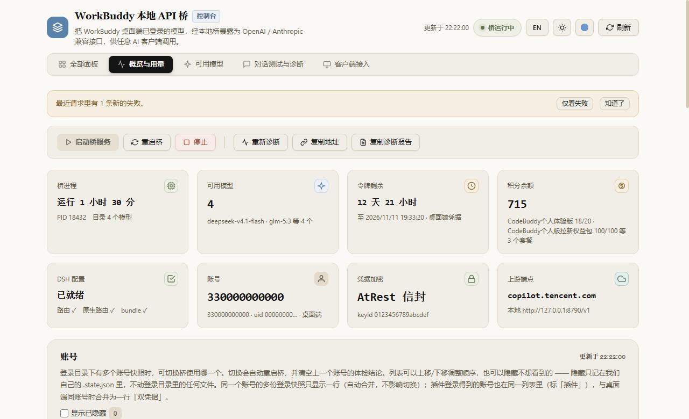
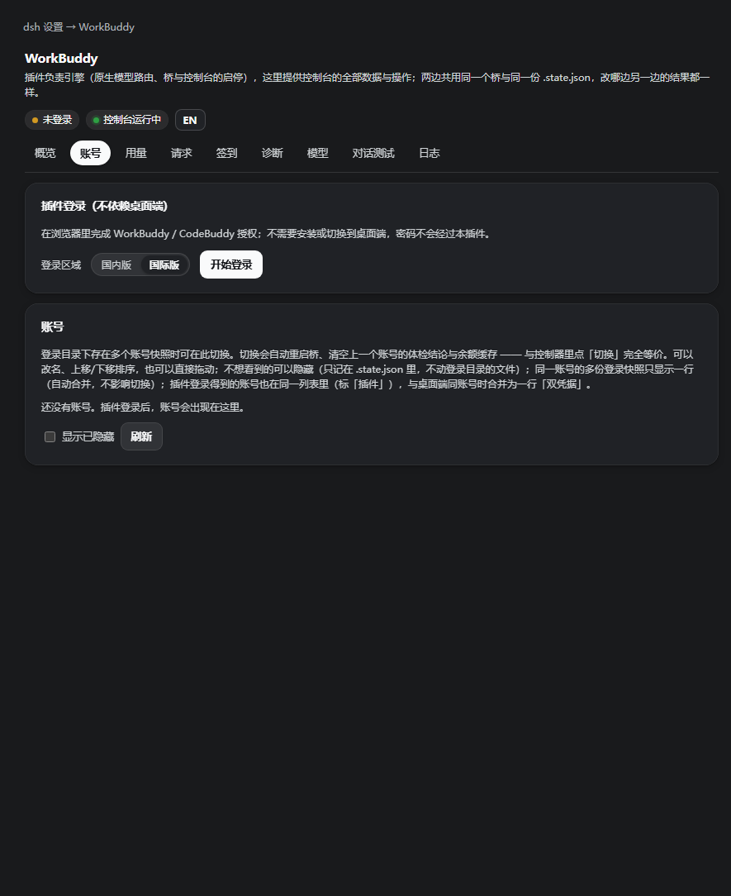
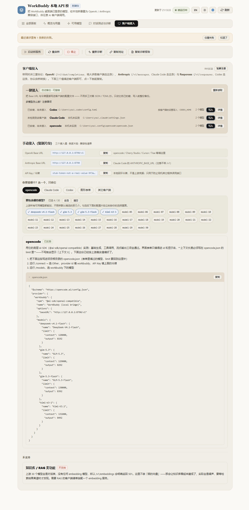
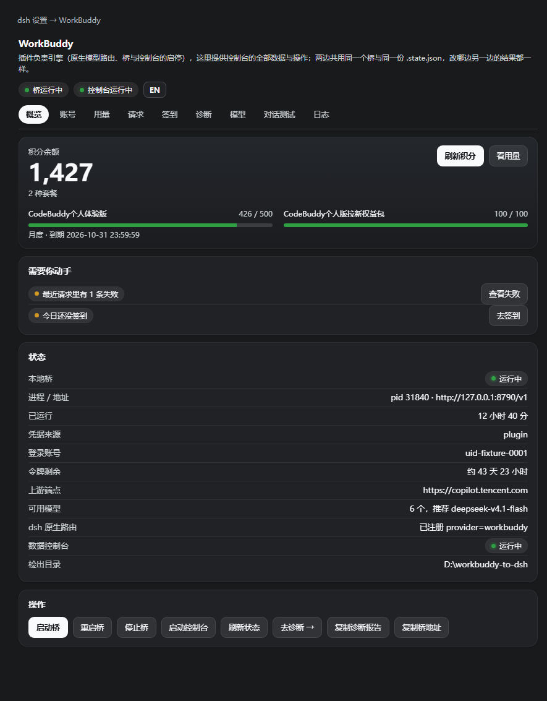
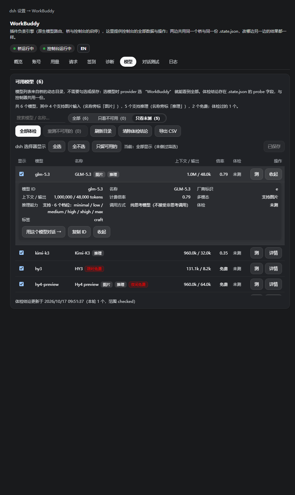

# WorkBuddy 本地 API 桥

> 🌏 English summary: [README.en.md](README.en.md)

把本机 **WorkBuddy** 的模型能力（DeepSeek / GLM / Kimi / MiniMax 等），
经一个本地桥变成本机的 **OpenAI 兼容**、**Anthropic 兼容**与 **OpenAI Responses**
三套接口 —— **Claude Code**、**Codex**、**opencode**、**Cursor**、**Trae**、
**Cherry Studio**、**NextChat**、**LobeChat**、**Open WebUI** 等任何支持自定义
Base URL 的客户端都能直连。

凭据有两种来源：已登录的 **WorkBuddy 桌面端**，或者 **dsh 插件里的「插件登录」**——
**没装过桌面端也能用**，只需在浏览器完成一次授权（凭据由插件 DPAPI 加密保管）。

另附一个网页控制台（状态 / 启停 / 诊断 / 模型注册 / 用量 / 体检 / 对话测试），
**中 / 英双语**（右上角切换，选择记在本机），
以及一个可选的 **DeepSeek Harness（dsh）原生插件**（见下方说明）。

> **一句话**：WorkBuddy 的模型额度 → 本地 API → 你惯用的任意 AI 客户端。

<picture>
  <source media="(prefers-color-scheme: dark)" srcset="docs/console-hero-dark.png">
  
</picture>


**关键词**（便于检索，按关心的问题分组）：

| 你在找什么 | 相关词 |
|---|---|
| 把 WorkBuddy 用起来 | WorkBuddy · WorkBuddy 本地 API · WorkBuddy 模型桥 · WorkBuddy 中转 · WorkBuddy 插件 |
| 接某个客户端 | **WorkBuddy 接入 Claude Code** · **WorkBuddy 接入 Codex** · WorkBuddy OpenAI 兼容 API · WorkBuddy Anthropic Messages 兼容 · WorkBuddy Responses 兼容 · Claude Code 自定义 API · opencode / Cursor / Trae / Cherry Studio / NextChat / LobeChat / ChatBox / Open WebUI 接入 |
| 接 DeepSeek Harness | DeepSeek Harness 插件 · **在 DSH 里用 WorkBuddy** · WorkBuddy 接入 dsh · dsh workbuddy · dsh 模型路由 · provider workbuddy |
| 技术特性 | openai-compatible · anthropic-compatible · llm proxy · local model bridge · 零依赖 Node.js · 仅监听 127.0.0.1 · 本机凭据自用 |

### DeepSeek Harness 用户：一个插件装下全部能力

在 **DeepSeek Harness（dsh）** 里用上 WorkBuddy 的模型，本仓库提供的是
**原生 dsh 插件 + 本地 API 桥 + 可视化控制台**的完整组合 —— 装完模型直接出现在
dsh 的模型选择器里，日常需要的接入、管理、监控、运维能力也全在同一个插件内。

#### 一键即用：装完插件，三步开始对话

| 步骤 | 操作 | 需要配置 |
|---|---|---|
| 1 | 安装插件（dsh「添加插件」填 GitHub 地址 / `dsh plugin add ...` / tgz） | **无** |
| 2 | 设置 → WorkBuddy → 「账号」→「开始登录」（授权页自动打开） | **无** |
| 3 | 浏览器授权完成，回模型选择器选一个模型 | **无** |

- **没装桌面端也能用**：插件内设备码登录，不下载、不安装 WorkBuddy 客户端。
- **装了桌面端更省事**：已登录的账号自动复用，第 2 步都可以跳过。
- **不填任何东西**：不需要 API Key、Base URL、令牌、端口或环境变量；桥与控制台由插件自动拉起。
- **国内 / 国际版自动预选**：登录区域跟随现有账号或桌面端域名，不用每次手动切。
- **模型选择器即时刷新**：登录、切号、重启桥后自动广播目录更新，不需要重启 dsh。
- **聊天页闭环**：未登录时空会话里直接「连接 WorkBuddy」；已有对话遇到凭据失效时，顶部胶囊位会变成登录入口。对话页顶部常驻「积分 N」（悬停看套餐余量 / 今日已用 / 最近一次，点一下刷新）；每轮回复末尾显示本轮积分（优先按本轮 tokens 与本地账本核对）。
- **模型名自带倍率**：选择器/聊天顶部直接显示 `DeepSeek-V4.1-Flash · ×0.11`，免费模型标「免费」，不用再翻模型详情。
- **凭据不裸奔**：DPAPI + AES-GCM 加密保存；同一账号的桌面/插件双凭据自动合并，401/403 自动接管。



#### 聊天页里，常用的都在手边

| 位置 | 显示 | 说明 |
|---|---|---|
| **模型名** | `DeepSeek-V4.1-Flash · ×0.11` / `· 免费` | 倍率来自模型目录，选模型时就能看到；不用点进详情 |
| **对话页顶部** | `积分 715` | 悬停看套餐余量 / 今日已用 / 最近一次调用；余量 ≤30% 变黄、≤10% 变红；点一下强制刷新。读取失败时保留上次余额并标红；已有对话但未登录/凭据异常时，这里直接变成登录入口 |
| **每轮回复末尾** | `本轮 0.03 积分` | 优先用宿主给出的本轮 tokens 与本地请求账本核对，拿到实际扣费；旧宿主或核对不上时退回「最近一次已完成请求」估算并标 `≈`（悬停有说明） |
| **空会话欢迎区** | `连接 WorkBuddy` | 未登录时直接发起浏览器授权，不用先进设置页；成功后模型选择器自动刷新 |

> `×0.11` 是**积分消耗倍率**，不是人民币单价；免费模型直接标「免费」。
> 积分胶囊、登录入口、每轮成本都在 dsh 对话页；完整用量曲线、请求明细和 CSV 仍在设置页的「用量 / 请求」里。

能力清单：

| 能力 | 说明 |
|---|---|
| 零配置接入 | 不需要 API Key、不需要手填端点 —— 桌面端已登录就直接复用；**没装桌面端**可在插件里完成一次浏览器授权，凭据由插件 DPAPI + AES-GCM 加密保管 |
| 原生模型路由 | 运行时注册 `provider: workbuddy`，**不写任何配置文件**；上游加减模型自动跟随 |
| 模型管理 | 勾选启用 / 禁用、同步到 dsh、**体检**（可用性 · 消耗倍率 · 实测成本）、详情与 CSV 导出 |
| 账号切换 | 登录目录下多个账号一键切换（自动重启桥、清缓存）；**同一账号的多份登录快照自动合并成一行**（不会再看到两个一样的账号），可给账号起自定义名字便于区分 |
| 积分与用量 | 积分余额；1 / 7 / 30 天趋势（次数 / tokens / 积分）、积分排行、CSV 导出；视频/图片单列提交次数与**消耗积分（提交前后余额差估算）** |
| 请求明细 | 逐条记录（模型 / 耗时 / token / 积分 / 结果），失败标红、上游错误码一键复制 |
| 环境诊断 | 逐项检查按优先级排序（红色项不解决，模型就不会出现）；含**客户端安装布局体检**（两个 WorkBuddy 客户端被装进同一目录会被点名并给出修法）；另有 CLI 自检 `doctor.mjs` |
| 对话测试 | 多轮流式对话，按轮次显示 token / 扣分 / 耗时，附桥日志 |
| 每日签到 | 自动签到（不开控制台也会签）+ 手动领取 |
| 同时服务其它客户端 | 桥讲 OpenAI / Anthropic / Responses 三套协议 —— Claude Code、Codex、opencode、Cherry Studio 等直接接入 |
| 视频生成（本地 API） | 文生视频 / 首尾帧 / 参考图三种模式，异步提交 + 查询（可长轮询，上游同步完成时 200 直接返回）+ 下载跳转；走 WorkBuddy 账号积分，详见 [`docs/VIDEO-GENERATION.md`](docs/VIDEO-GENERATION.md) |
| 图片生成（本地 API） | 文生图 / 图生图两种模式，异步提交 + 查询（可长轮询，上游同步完成时 200 直接返回产物/失败原因）+ 下载跳转；与视频共用临时 key 与错误契约，详见 [`docs/IMAGE-GENERATION.md`](docs/IMAGE-GENERATION.md) |
| 中英双语 | 控制台与 dsh 设置页（9 个标签页）全部双语，右上角 `EN` / `中` 切换 |

**在 dsh 里直接装**：设置 → 插件 → 添加插件，填

```text
github:Ianzhyh/workbuddy-to-dsh
```

安装源保持默认即可（GitHub 地址由 pnpm 直接拉取，国内镜像只影响 npm 依赖）。
也可以走命令行（安装路线、验收清单与故障排查见 [docs/INSTALL.md](docs/INSTALL.md)）：

```sh
dsh plugin --profile desktop add github:Ianzhyh/workbuddy-to-dsh
```

> npm 包名 `workbuddy-to-dsh` 已按可发布形态准备好；发布后「添加插件」里直接填
> `workbuddy-to-dsh` 即可（npm 名 `dsh-plugin-workbuddy` 已被他人占用，不要填它）。

装完**重启一次 dsh**，模型选择器里直接多出 WorkBuddy。

> **插件登录需要 v1.8.0 或更高版本**。从 dsh 市场安装时请确认上架版本；
> 旧版（≤1.7.0）仍要求 WorkBuddy 桌面端登录态。

> ### ⚠️ 请先读这一段（免责与边界）
>
> **这是一个自托管的开源工具：欢迎自用、欢迎分享源码，但它是非官方路径，风险自担。**
>
> - **非官方路径。** 它依赖 WorkBuddy 未公开的上游协议与登录凭据格式（**插件登录
>   不需要桌面端**，但同样走非官方设备码接口）。上游随时可能改动协议或收紧风控
>   （已经发生过——见[故障排查](docs/TROUBLESHOOTING.md)里的真实案例），**可用性
>   无任何保证**，且**不承诺任何兼容性**。把它当作「随时可能需要更新甚至失效的
>   互操作性实现」，而不是稳定服务。
> - **只驱动你自己的账号。** 它只读取**你自己机器上已登录**的桌面账号，或你在插件里
>   明确授权的那一个插件账号，消耗该账号自身的配额。**请勿**用它做多账号池化、
>   代他人调用、或任何形式的转售 / 托管服务 —— 那既违背本项目的设计初衷，也最容易
>   触发上游风控（殃及所有用户）。
> - **请确认你符合 WorkBuddy 的服务条款。** 使用前请自行阅读并确认；若条款不允许，
>   请不要使用本项目。
> - **无担保。** 按 MIT 许可"按现状"提供。作者不对账号风控、额度异常或任何损失负责。
>   若你需要长期稳定、可商用的模型接入，**请申请官方 API**。
> - **自担风险的分享是欢迎的**：转发仓库链接、写教程、提 PR 都可以；但请**不要**
>   打包转售、绑定付费，或以本项目名义收集任何人的凭据。

### 这个项目与同类工具的关系

- **方向与 [claude-code-router](https://github.com/musistudio/claude-code-router) 相反**：
  CCR 把别家的 API **注入** Claude Code；本项目把 Claude Code 等**发给 WorkBuddy 的
  模型额度导出**成标准 API——两者互补而非竞争。
- **与 WorkBuddy2API 集群（社区 20+ 同目标项目）的差异**：本项目刻意保持
  **单账号 · 不落明文凭据 · 零运行时依赖 · 自包含**（桌面凭据现取现解；
  插件登录凭据以 DPAPI + AES-GCM 加密保存）；不支持也不计划支持多账号池化与
  任务自动化——如果你的需求是后者，社区里已有更对口的工具。
- 上游协议是**未公开接口**：所有同类项目都在同一片雷区里，失效与修复是常态。
  本项目的对策是[把排查写清楚](docs/TROUBLESHOOTING.md)（症状、证据、处置），
  而不是承诺稳定。
> - 详细的风险与边界见 [注意事项](#注意事项) 与 [docs/SECURITY.md](docs/SECURITY.md)。

**本仓库还提供一个 DeepSeek Harness 原生插件**（[`dsh-plugin/`](dsh-plugin/README.md)）：
装进 dsh 后，模型选择器里直接多出 provider `WorkBuddy`，设置里多一页 9 个标签页的数据面板；
插件自带桥与控制台，拷一个文件夹就能用。**它是可选的** —— 不用 dsh 的话，
前面说的本地 API 照常可用，只是没有那个原生集成。

只在本机回环地址上工作，不对外暴露，不内置任何密钥。

```sh
# ── 第 1 步：跑起来（所有用法都需要，与 dsh 无关）──────────────────────
git clone https://github.com/Ianzhyh/workbuddy-to-dsh.git
cd workbuddy-to-dsh
# 然后双击 启动.cmd —— 桥和控制台都会自动起来，不需要 npm install

# 或者只要桥、不开控制台：
bridge\start-bridge.cmd
```

跑起来后，去控制台「客户端接入」页签拿 Base URL 与令牌填进你的客户端
（见 [接入你的客户端](#接入你的客户端)）。**到这里就已经能用了。**

```sh
# ── 第 2 步（可选）：再装进 DeepSeek Harness ──────────────────────────
# 只有用 dsh 的人需要。三种方式装的是同一个插件，任选一种。

# 方式一：一条命令直装（v1.1.0 起，仓库根已声明 dsh.bundle）
dsh plugin --profile desktop add github:Ianzhyh/workbuddy-to-dsh

# 方式二：release 附件（tgz 安装包，无构建、无需 allowBuilds 授权）
#   从 GitHub Releases 下载 dsh-plugin-workbuddy-<版本>.tgz 后：
dsh plugin --profile desktop add ./dsh-plugin-workbuddy-1.14.0.tgz

# 方式三：从源码（插件在 dsh-plugin/ 子目录，接第 1 步的 git clone）
dsh plugin --profile desktop add workbuddy-to-dsh/dsh-plugin
# 装完重启一次 dsh；之后：设置 → WorkBuddy
```

> 三种方式装的是**同一个插件**。方式一/二由 npm 装仓库根包（Loader 行 name =
> `workbuddy-to-dsh`，对应根目录的 cordis.patch.yml）；方式三按子目录安装
> （name = `dsh-plugin-workbuddy`，对应 dsh-plugin/cordis.patch.yml）。
> 两份 patch 除 name 外完全一致，改动时需同步。

> 插件是**自带一切**的独立包（`npm run vendor` 生成的 `vendor/` 里含桥与控制台），
> 可以直接把 `dsh-plugin/` 文件夹拷给别人，对方不需要本仓库。
> 安装路线、验收清单与九条故障排查见 [docs/INSTALL.md](docs/INSTALL.md)。

---

## 它解决什么问题

WorkBuddy 的上游后端本身就讲 OpenAI 协议，官方只是没有开放公开入口，鉴权依赖桌面端
的登录会话。所以就协议层面而言，只需要一个薄薄的转发层。

真正的工程难点在于**从 WorkBuddy 5.6.0 起，官方开启了 AtRest 加密**：登录文件里的
`accessToken` / `refreshToken` 从明文 JWT 变成了 AES-256-GCM 信封，而解密密钥不落盘、
只存在于客户端进程内。这让所有在进程外读取该文件的既有工具全部失效。

本项目的做法是**请客户端自己完成解密**：以 `ELECTRON_RUN_AS_NODE=1` 运行
`WorkBuddy.exe`，调用它自己的原生绑定 `loggerGet()`，由客户端交出它本来就在用的
那把密钥。**没有任何密钥被写进代码或磁盘，登录文件也始终只读。**

没装桌面端时走另一条路：插件的「插件登录」用设备码在浏览器完成授权，桥直接使用
插件自己保管的凭据（DPAPI 保护密钥 + AES-GCM 信封；不依赖桌面端进程）。

> 这里刻意不做「破解」：不逆向密钥派生、不硬编码密钥、不改写登录文件。
> 密钥始终由客户端进程提供，本项目只是把它的结果用起来 —— 这也是它能长期跟上
> 客户端版本变化的原因。实现细节见 [`lib/atrest.mjs`](lib/atrest.mjs)。

---

## 前置条件

| 条件 | 说明 |
|---|---|
| Node.js | **18 或更高**（开发验证于 22.22.2）。无 npm 依赖，无需 `npm install` |
| WorkBuddy 桌面端 | **已安装且已登录**，进程可用（模型由它铸造的令牌驱动）；**或者**不装桌面端，用 dsh 插件里的「插件登录」完成一次浏览器授权（凭据由插件 DPAPI 加密保管，见 [dsh-plugin/README](dsh-plugin/README.md)） |
| DeepSeek Harness | 可选。只有要接入 dsh 时才需要；桥本身对任意 OpenAI 客户端都可用 |
| 操作系统 | **Windows**（已验证）。macOS / Linux 的路径与调用逻辑已实现、也在 CI 矩阵里跑过单测，但**凭据解密未实测** |

> **复用桌面端登录态目前只支持 Windows**：解密的密钥**不在本包里**，每次由 WorkBuddy 客户端
> 自己的 Electron 原生绑定现取，这条路只在 Windows 上验过。插件包虽然声明了 `os: ["win32"]`，
> 但那个字段**只对 npm 生效**（`npm install` 会报 `EBADPLATFORM`）；dsh 的插件安装走它自带的
> pnpm，**pnpm 不检查 `os`**（实测 11.7.0）—— 所以非 Windows 上**装是装得上的**，
> 只是大概率卡在「读不出登录凭据」。
>
> **插件登录不依赖这个二进制**，但加密落盘用的 DPAPI 仅 Windows 可用；其他平台会自动退回
> 仅内存（桥重启后需重登），且这条路径尚未实机验证。要试请按实验对待。

> 桥只驱动**本机已登录**的账号，不绕过任何鉴权，也不提供任何绕过方式。

---

## 快速开始

**双击根目录的 `启动.cmd`。就这一步。**

它会自动定位 Node.js、启动服务、并在浏览器里打开控制台——桥也会被自动拉起，
不需要任何手工操作。打开后即可看到桥已就绪和完整的模型列表。

> **首次使用**：桥起来之后，去「客户端接入」页签拿到 Base URL 与令牌，填进你的客户端即可
> —— 见下方[接入你的客户端](#接入你的客户端)。
> 若用 DeepSeek Harness，另外在「可用模型」里勾选所需模型并点「保存到 dsh 设置」，
> 再重启一次 dsh，模型就会出现在它的选择器里。

三个"不需要"：

- **不需要 `npm install`** —— 本项目零依赖
- **不需要改配置** —— 所有项都有合理默认值，`.env` 是可选的
- **不需要手工启动桥** —— 控制台会自动启动它（并复用已在运行的实例）

> 窗口保持打开即可。关掉窗口会停止控制台；桥在后台继续驻留，下次启动直接复用。

不想开控制台也可以（用的是同一套配置）：

```cmd
bridge\start-bridge.cmd     :: 只起桥
node tools\doctor.mjs       :: 命令行自检，输出缺失项与修法
```

### 把安装交给 Agent

不想照着文档一步步来？把下面这段话**整段粘给任意 AI Agent**（WorkBuddy 对话、
Claude Code、opencode…），它会替你完成判定 → 安装 → 验证，出错时自己查排错文档：

```text
请帮我在本机安装并验证 workbuddy-to-dsh（WorkBuddy 本地 API 桥）。步骤：

1. 环境判定：确认 Node.js 18+（node -v）。凭据二选一：WorkBuddy 桌面端已安装并
   登录过（Windows 下检查 %LOCALAPPDATA%\CodeBuddyExtension\Data\Public\auth\ 里
   是否有 .info 登录文件）；或者没装桌面端，稍后在 dsh 插件里用「插件登录」。
2. 获取代码：git clone https://github.com/Ianzhyh/workbuddy-to-dsh 并进入目录。
   本项目零依赖，不需要 npm install。
3. 启动：Windows 双击根目录的 启动.cmd（或 node dashboard/server.mjs）——它会自动
   启动桥并打开控制台（http://127.0.0.1:8792）。
4. 验证：运行 node tools/doctor.mjs 自检全部通过；再请求模型目录（令牌见下）：
   curl -H "Authorization: Bearer <本地令牌>" http://127.0.0.1:8790/v1/models
   确认返回模型列表。
5. 若我是 DeepSeek Harness 用户：改用 dsh plugin add github:Ianzhyh/workbuddy-to-dsh
   直装插件，然后在 dsh 设置页的 WorkBuddy 分区完成模型注册并重启 dsh；
   没有桌面端就在「账号」页点「开始登录」，完成浏览器授权。
6. 遇到问题先读 docs/TROUBLESHOOTING.md，按里面的处置试过再带报错来问我。
全程只允许 127.0.0.1 本机回环，不要尝试改绑 0.0.0.0 或暴露到局域网。
```

---

## 接入你的客户端

<picture>
  <source media="(prefers-color-scheme: dark)" srcset="docs/clients-panel-dark.png">
  
</picture>

桥同时讲**三套协议**，填哪个地址取决于客户端讲哪套：

| 协议 | Base URL | API Key |
|---|---|---|
| OpenAI 兼容 | `http://127.0.0.1:8790/v1` | 本地令牌（见下方说明） |
| Anthropic Messages | `http://127.0.0.1:8790`（**不带 `/v1`**） | 同上 |
| OpenAI Responses（Codex） | `http://127.0.0.1:8790/v1` | 同上（写在 `~/.codex/config.toml` 的 `experimental_bearer_token`） |

> **Codex 为什么不能只改 Base URL？** 它说的是 **Responses 协议**，而桥的 `/v1` 那套
> 是 chat/completions；两者的事件流与请求体都不同，所以桥里做了一层真正的协议转换
> （CC Switch 靠一个本地路由进程做的事，这里内置了，不用再装中间人）。
> 注意网上仍在流传 `wire_api = "chat"`，**上游已经把它移除**，照抄会直接报错 ——
> `"responses"` 是现在唯一还能用的值。

**不想手抄配置？控制台面板最上面有「一键接入」**：它检测本机装了哪些客户端
（Codex / Claude Code / opencode），把 Base URL 与令牌**直接写进**它们的配置文件 ——
只动它自己的键（cc-switch 写过的节一字不动）、写入前整份备份、支持一键撤销、
写完拿配置里的令牌真打一次桥验证。不想开控制台也可以用命令行：

```cmd
npm run connect status          :: 三个客户端各自的状态与将要改动什么
npm run connect apply codex     :: 写入（codex / claude / opencode）
npm run connect apply codex --models glm-5.3,kimi-k3-1   :: 一次接多个模型
npm run connect verify codex    :: 静态读回 + 端到端验证
npm run connect undo codex      :: 撤销
```

**多模型**：勾选几个就接几个，其中一个作为主模型（客户端打开时用的那个）。
改完勾选要**点一次「重新写入」**才会进客户端（勾选只改面板状态，不碰你的配置文件）；
写完之后那行显示的个数会跟着**真正写进去的那批**走，两边不一致时不会互相遮掩。
三个客户端的机制不同，写进去的形状也不同 —— 但都是客户端**自己认**的写法：

| 客户端 | 写什么 | 在客户端里怎么切 |
|---|---|---|
| opencode | provider 下的**模型表**（`models`） | TUI 里直接选 |
| Claude Code | **`modelPicker`** 列出勾选的模型（替换掉内置列表） | `/model` 选择器 |
| Codex | **模型目录文件**（`model_catalog_json`） | `-m <模型>` 或模型选择器 |

> Codex 的目录是**合并**的：`model_catalog_json` 已经指向别人的目录时（cc-switch 就是
> 常见的一种），原条目一条不动，只补桥这边缺的；撤销连那份文件一起还原。
> 本机找不到可用的目录模板时**不生成**，界面会直说"只能接一个模型"，不硬编造。

> **opencode 的配置文件名**：官方同时认 `opencode.json` 与 `opencode.jsonc`
> （JSON with Comments）。我们**挑你已有的那个改** —— 你那份叫 `.jsonc` 就改 `.jsonc`，
> 不会在旁边多造一个 `.json`（按文档优先级那会盖住你自己的文件，把你写在里面的
> 设置顶掉）。两个都在时用 `.json`。
> 注意：JSON 这条路写入会**重排成 2 空格缩进**，`.jsonc` 里的注释会一并丢掉
> （写入前整份备份、可撤销，界面也会提示"该文件会被重新排版"）。

**不改我的配置（Codex 的 profile 通道）**：如果你不想让接入动到 `~/.codex/config.toml`，
可以用 profile 这条**零写入**的路 —— 它只写 `$CODEX_HOME/workbuddy.config.toml`，
你原来的配置**一个字节都不动**：

```cmd
npm run connect profile codex            :: 只写 profile 文件，基础配置不动
codex -p workbuddy                       :: 用这个 profile 启动 Codex
npm run connect undo codex-profile       :: 不想要了就删掉（基础配置始终没被碰过）
```

面板里等价的操作：Codex 那一行 →「详情」→ **不改我的配置（可选）** →「写入 profile 文件」。

依据是 Codex 自己的 `-p/--profile`（`codex --help`：*Layer `$CODEX_HOME/<name>.config.toml`
on top of the base user config*）。因为基础配置没被碰过，这条路**不需要**备份/撤销/
权限收紧那一整套安全网 —— 它是"便捷性与安全性同时更好"的那一档。

> ⚠️ **桌面应用不接受命令行开关**（`-p` / `-c` 都是 CLI 的参数），所以这条通道只对命令行生效。
> 用桌面应用的话仍然走上面那条"写基础配置"的路。界面与命令行都会把这条限制写出来。

**随时切回客户端自己的模型**：面板里每个客户端的「详情」里有一个**模式**区块，
在「走桥」与「客户端自己的模型」之间来回切（命令行：
`npm run connect native codex` / `npm run connect bridge codex`）。

切回原始模型会按记录把配置**逐键还原成接入之前的样子**（连注释与空行都在），
`model_catalog_json` 一并还原 —— 客户端打开时用的就是它自己原来那个模型，
模型选择器里也是它自己的清单。我们那份模型目录文件留在磁盘上但不被引用，
随时能一键切回来。切回原始模型**不需要桥在跑**（它只动配置文件），
所以"桥挂了、我又不想用桥了"这种时候照样能用。

> 它与「撤销接入」的分工：**撤销是拆掉**（记录归档、我们建的目录文件删掉，
> 再想用桥得重新接入一遍），**切模式是换挡**（记录与目录都留着）。
> 一个客户端能同时被接入多次、来回切多少次，"撤销"还原的始终是最初那一份配置。

**这块面板的纪律**（都是"界面不说假话"的具体做法，踩过坑才有的）：

- **读不到状态就说读不到**：接口 404 / 超时 / 返回形状不对时给出原因 + 「重试」，
  绝不挂着一句「正在读取接入状态…」永远转圈（实测踩过：控制台进程还在跑改动前的
  旧代码，`/api/connect` 回 404，面板从头到尾一个字都没渲染出来）；
- **「已接入」不是一个文件的存在性**：配置被手改过、桥换过端口/令牌，标签会变成
  「已接入，需重新写入」；反过来，你自己照片段抄进去的配置会被认成
  「已接入（非本控制台写入）」。已接入的行可以随时点**「验证接入」**——
  静态读回 + 拿配置里的令牌真打一次桥，失败结论直接落在标签上
  （「已接入，验证未通过」）；
- **「桥没起」与「桥在跑但不认这把令牌」分开说**：前者去点「启动桥服务」，
  后者去点「重启桥」。混成一句时用户会按错的按钮，然后卡住
- **写进去几个就显示几个**：面板上的「N 个模型」不许自己念自己那份勾选状态。
  写入成功后以服务端回报的**实际集合**为准（实测踩过：请求里漏发了勾选的那批模型，
  服务端于是把旧的又写了一遍，界面却一直显示用户勾的 5 个 —— 面板永远停在
  「需重新写入」，而用户没有任何办法看出差异，重启客户端多少次都一样）
- **"还没写入的勾选"要留住**：勾好但没点写入时刷新页面，不该回到配置文件里那批。
  选择存在浏览器本地（只存模型 id，不存任何凭据），刷新后恢复，并且真的发给服务端
  —— 只在界面上显示没用，预览与写入都得按它算
  （见 [TROUBLESHOOTING](docs/TROUBLESHOOTING.md)）；
- **布局按"一年看几次"排序**：主路径只有三行客户端（状态 · 名称 · 路径 · 操作），
  说明、三个接入值、各家配置片段、兼容性清单都收进折叠区 ——
  自己抄配置那条路照样完整，只是不再天天占着屏幕。

> 标了「本机未实测」的客户端：写入逻辑有往返单测，但本机没装它，
> 所以「它是否认这份配置」没法替你保证 —— 其余客户端仍走复制片段。

**指定接入模型**：一键接入默认为每个客户端写入桥对应的默认模型（Codex / Claude Code 用
`glm-5.3`，opencode 用精选集首个）。控制台面板里每个客户端都带一个「接入模型」下拉，写入前
可直接改；命令行用 `--model`：

```cmd
node tools\connect.mjs apply codex --model glm-5.3
```

所选模型会写进各客户端配置（Codex `config.toml` 的 `model`、opencode 的 `model`、Claude Code 的
`env.ANTHROPIC_MODEL`），桥收到后精确命中目录即原样使用 —— 选什么就跑什么。写入前会校验该 id
在当前目录里，避免写错导致桥静默回退到别的模型。

> **本地令牌从哪来？** 首次启动时随机生成，控制台的「客户端接入」面板里直接显示并
> 可一键复制（页面上的值就是准的，不用去翻文件）。需要手动读时它在
> `dsh-plugin/.bridge-token`；也可在 `.env` 里用 `WORKBUDDY_LOCAL_TOKEN=` 显式指定。

控制台的「客户端接入」页签里有每个客户端的完整配置片段，点一下即可复制。

**兼容性分三档，如实标注、不夸大：**

| 客户端 | 协议 | 状态 |
|---|---|---|
| opencode | OpenAI | ✅ 已实测 —— 用其底层 AI SDK（`@ai-sdk/openai-compatible`）跑通生成 / 工具调用 / 流式。**接入**那一步：本机装的是桌面版（无头驱动不了），所以配置的**合法性**用官方 schema 验（`npm run check:opencode`，当前 16 个键全过），"桌面版真的读进去并调通"仍需人工点一次 |
| Claude Code | Anthropic | ✅ 已实测 —— 流式事件序列、`tool_use`、多轮 `tool_result` 往返均正确 |
| Codex | Responses | ⚪ 未在 Codex 内实跑 —— 但协议层是照 Codex 的**解析器源码**逐条对齐的（SSE 事件顺序、工具名分片重组、usage 三总数），并有单测覆盖 |
| Cursor / Trae | OpenAI | ⚪ 协议兼容，未在客户端内实测（Agent 模式依赖的工具调用桥侧可用） |
| Cherry Studio / NextChat / LobeChat / ChatBox / Open WebUI | OpenAI | ⚪ 协议兼容，未在客户端内实测 |

> 「协议兼容」= 这些客户端只用 `/v1/models` 与 `/v1/chat/completions` 两个端点，
> 桥侧已验证；但**没有真的装一遍跑通**，所以不写成「支持」。

**Claude Code 的模型名会被映射。** 它发的是 `claude-sonnet-4-…`，上游没有这些 id，
桥会映射到真实模型（默认 `glm-5.3`）。想指定就用 `WORKBUDDY_ANTHROPIC_MODEL=<上游真实模型 id>`；
走「一键接入」时会把你选的模型直接写进 `settings.json` 的 `env.ANTHROPIC_MODEL`，无需再设环境变量。

**已知限制：知识库 / RAG 用不了。** 上游只提供对话模型，没有任何 embedding 模型，
`POST /v1/embeddings` 会明确返回 **501**。需要 RAG 的客户端请另配一个 embedding
提供方——桥不做「假的向量」，那会让知识库看起来建成了、实际全是噪声。

---

## 作为 DeepSeek Harness 插件使用



本仓库同时提供 **DeepSeek Harness 原生插件**（[`dsh-plugin/`](dsh-plugin/README.md)）。
**插件和「桥 + 网页控制台」是一套东西的两个前端，不是二选一** ——
用不用 dsh 都能用这个项目，只是装了插件多一层原生集成：

> **插件当引擎，控制台的全部功能搬进 dsh 设置页 —— 两个前端、一个后端。**

设置页右上角有 **`EN` / `中` 语言开关**，9 个标签页的界面文案全部双语
（与控制台同一套词条思路；上游数据保持原样不翻）：


> 插件在 dsh 里注册原生模型路由、把**桥和控制台都管起来**（已在跑就复用，没跑就拉起）；
> **设置 → WorkBuddy** 里有 9 个标签页：概览 / 账号 / 用量 / 请求 / 签到 / 诊断 / 模型 / 对话测试 / 日志，
> 与控制台网页共享同一个桥、同一份 `.state.json`（账号切换等写操作由插件透传给控制台执行，
> 保证只有它写），在任意一边改，另一边同步变化。**按模型编辑输入/输出 Token 是插件面板
> 额外提供的能力**，控制台网页只读展示；原控制台照常可用。

| | 装插件后 | 不装插件 |
|---|---|---|
| 模型注册 | 运行时注册 provider `workbuddy`，**不写任何配置文件** | 控制台写 `settings.yaml` + profile patch |
| 模型增删 | 动态跟随上游目录，改完即生效 | 需要重新勾选并保存 |
| 上下文 / 输出 | **模型详情顶部可编辑**：输入/输出并排，滑块 + 数值框，留空 = 自动，Token 改完自动保存 | 只能改 `.env` 的 `WORKBUDDY_CONTEXT_WINDOW`（全局默认） |
| 活动倍率 | 解析上游 `schedule`：夜间免费（hy4）23:00–08:00 自动显示免费/0，夜间折扣（glm）显示折后倍率，过期活动自动隐藏；dsh/面板/控制台同源 | 静态倍率，需自己看公告 |
| 桥的启停 | 插件自动复用/拉起 | 控制台按钮，或 `启动.cmd` |
| 数据界面 | **dsh 设置页（9 个标签页）** + 控制台网页，两边同步 | 只有控制台网页 |
| 网页搜索 | **启动后自动接入（默认）**，概览顶部独立状态卡 + 一键接入/恢复；令牌写独立引用，不覆盖 DeepSeek key | 需手动改 dsh 的 `web-search-deepseek` 配置 |
| agent 侧 | 10 个工具（含 `workbuddy_web_search` 原生搜索兜底、`workbuddy_generate_video` / `workbuddy_video_status` 视频生成与查询、`workbuddy_generate_image` / `workbuddy_image_status` 图片生成与查询）+ `/workbuddy` 命令 | 无 |

概览**最上方**的「网页搜索」独立卡片会按「配置 + 桥存活 + 令牌匹配」显示是否真的
可用（不再藏在「操作」里；旧宿主没上报状态时也会显示重启提示与手动入口）。插件启动、
桥就绪后**默认自动接入**（issue #7）：用户显式配过 `baseURL` / key / `searchProvider`
就完全不碰；桥换了端口或本地令牌轮换会自动自愈；点「恢复接入前配置」会还原并关闭自动
接入，之后不再自动重连。自动接入时卡片会注明；自动失败会显示原因并保留「一键接入」
按钮，也可以用 `WORKBUDDY_AUTO_WEB_SEARCH=0` 永久关闭。接入后插件会把桥令牌写进独立
凭据引用、用 dsh 自己的 web 服务真搜一次做自检，并保留最近一次的时间/来源数。

即使 dsh 内置搜索仍指向 DeepSeek（或 key 失效），agent 还可以用
`workbuddy_web_search` 工具直接走桥的 WorkBuddy 原生搜索，不依赖 dsh 的搜索配置。
视频同理：dsh 里可以直接让 agent 调用 `workbuddy_generate_video` 提交（文生视频 /
首尾帧 / 参考图），再用 `workbuddy_video_status` 查询；提交是计费动作，工具文案会明确
提醒不要重复提交。详见
[`dsh-plugin/README.md`](dsh-plugin/README.md#让-dsh-的网页搜索走-workbuddy不消耗-deepseek-钱包)。

```sh
dsh plugin --profile desktop add <本仓库路径>/dsh-plugin
```

装完**重启一次 dsh**（插件模块与客户端引导行只在启动时组装）。
两种方式可以共存：控制台照旧能开，桥是同一个进程；但**不要同时保留旧的手写
`llm-pi-ai.providers.workbuddy` 路由**——插件首次加载会自动把它清掉（先备份）。

### 上下文窗口（Token）



模型 → 详情顶部就是这张表单：

- **输入 / 输出并排**：输入 = dsh 上下文预算，输出 = 发给上游的 `max_tokens`；
  两行都是「滑块粗选 + 数值框精确」，支持 `128K` / `1M` / `131072`，留空 = 自动。
- **改完自动保存**：滑块松开、输入框失焦或回车即落盘；temperature / 思考强度
  仍点「保存修改」一起提交。
- **下一轮请求生效**：保存后下一次请求会按新预算解析（同一会话也生效）；
  用量弹层的分母可能还停留在上一轮，发一条消息即可刷新；切换模型后按
  该模型自己的预算解析。面板状态显示「当前配置」。
- **不会被官方默认误判**：模型自己的「默认输入 300K + 输出上限 384K」是合法
  组合；输入/输出共享窗口只做非阻断提示，模型上限/下限仍硬校验。
- **精确回填**：`131072` 不会显示成 `128K` 后再存成 `128000`；输出上限同时
  显示精确 tokens。
- 覆盖值会标「自定义」，可用「已自定义（N）」筛选；偏好写入
  `<DSH_HOME>/workbuddy-model-prefs.json`，旧的插件目录文件在启动时自动迁移。

细节、配置项与验证记录见 [`dsh-plugin/README.md`](dsh-plugin/README.md)。

---

## 控制台

打开 <http://127.0.0.1:8792> 后：

| 区域 | 能做什么 |
|---|---|
| 顶部提示条 | 只显示**需要处理**的事：桥不可用 > 令牌临期 > 新失败 > 未签到；桥不可用不可关闭，其余可静默。标签页标题同步反映状态（含「新失败 N」） |
| 操作条 | 启动桥、重启桥、停止桥、重新诊断、复制桥地址（供其它 OpenAI 客户端填 Base URL）、**复制诊断报告**；危险动作都有二次确认（会提示将打断几条请求）；「刷新」一次覆盖全部面板 |
| 状态卡 | 账号、令牌剩余有效期、凭据加密方式、上游端点、**桥进程（PID / 运行时长 / 目录模型数）**、模型数、**积分余额**、dsh 就绪度 |
| 账号 | 登录目录下存在多个账号快照时，可在此切换桥使用哪一个（自动重启桥、记住选择，并清空上一个账号的体检结论）；**同一账号的多份登录快照只显示一行**（按账号合并，代表行取"生效中 > 可用 > 最近"，不会出现两个一样的账号）；可给账号起自定义名字（如「工作号 / 个人号」）、可上移/下移或拖动排序、可隐藏不想看到的（只改我们自己的 `.state.json`，**不动登录目录里的文件**）。在 WorkBuddy 客户端里换号后，桥会自动跟随桌面当前登录文件，不会继续显示旧账号 |
| 用量统计 | 最近 1 / 7 / 30 天的调用次数、token 数、平均耗时、**消耗积分**、失败数；**趋势图**可切指标（次数 / tokens / 积分）与粒度（按天 / 最近 24 小时），**积分排行**看「这段时间积分花在哪了」；可导出 CSV，也可**清空账本** |
| 最近请求 | 逐条请求明细（时间 / 模型 / 流式与否 / 耗时 / token / 积分 / 结果），**失败标红**并显示上游错误码，**点失败标签可一键复制错误详情**；支持**模型筛选** +「仅看失败」+ 40 / 100 / 200 条叠加，可**暂停自动刷新**、**导出当前筛选的 CSV**；只含元数据，不含对话内容 |
| 每日签到 | 查看今日签到状态与连续天数，一键领取；**每日自动签到**默认开启（桥自带定时器，**不开控制台、不调模型也会签**；签完即停，不做多余的检测），失败会留痕、可关闭 |
| 环境诊断 | 逐项检查，**按优先级排序**——红色项不解决，模型就不会出现；含客户端安装布局体检（国内版 + 国际版被装进同一目录会被点名并给出修法） |
| 可用模型 | **默认只把 WorkBuddy 官方模型选择器列出的模型放进 dsh**（与官方 GUI 一致）；网关注册但官方未上架的模型标「官方未上架」，默认不进 dsh，可先体检再在「显示官方目录外的模型」里勾选。模型详情（ⓘ）展示官方上下文（默认 / 可选档位 / 上限）、输出上限、**消耗倍率**与**实测成本**；**按模型的输入/输出 Token 编辑在 dsh 插件面板**（控制台只读展示；不装插件时用 `WORKBUDDY_CONTEXT_WINDOW` 设全局默认）。支持体检、一键取消勾选不可用、同步可用模型到 dsh、手动刷新目录；导出 CSV |
| 对话测试 | **多轮对话**（带上下文）、按轮次分段、显示本轮 token / 扣分 / 耗时、回答可复制；流式输出可随时停止；附带桥日志（可按关键字过滤 / 只看错误 / 只看本次启动 / 清空） |
| 客户端接入 | 桥的两套协议地址与本地令牌（**点一下即复制**），以及各客户端的完整配置片段与**如实的兼容性分档**（已实测 / 协议兼容 / 不支持）；「复制全部配置」一次抄走 |

每个面板的表头都显示「数据更新于 HH:MM:SS」，页面上出现的结论都能对得上时间。
所有图表都是自己画的**零依赖内联 SVG**（没有引入任何图表库）。

控制台的所有接口见 [`dashboard/README.md`](dashboard/README.md#api)。

---

## 工作原理

桥同时讲**两套协议**，因为客户端说的是两套：

```
OpenAI 系客户端（opencode / Cursor / Trae / Cherry Studio …）
   │  POST /v1/chat/completions
   │
Claude Code
   │  POST /v1/messages            ← Anthropic Messages 协议
   ▼
bridge/workbuddy-bridge.mjs
   │  1. 注入鉴权头（桌面凭据现取现解；插件凭据解密后仅驻内存）
   │  2. 保证流式（上游不接受非流式请求）
   │  3. 请求体归一化（developer → system、tool_choice 对象 → 字符串）
   │  4. Anthropic ↔ OpenAI 双向翻译（仅 /v1/messages 这条路径）
   ▼
copilot.tencent.com/v2/chat/completions   ← 上游只说 OpenAI 协议，且只支持流式
```

**OpenAI 那条路径基本不做协议翻译**——上游本来就说 OpenAI 协议，桥只做上面 1–3
三件适配。**Anthropic 那条必须翻译**：Claude Code 的请求结构、响应结构、流式事件
格式都与 OpenAI 不同，光把 Base URL 指过来会直接 404。

两条路径最终汇到上游同一个端点，所以**用量、积分、账本、控制台是统一的**。

网页搜索另走 WorkBuddy 的原生 `POST /agenttool/v1/search`：桥暴露
`POST /v1/web_search`，并在 `/v1/messages` 识别 `web_search_20250305`。dsh 的
Web search provider 把接口地址指到桥后，搜索走 WorkBuddy 账号、**不消耗 DeepSeek
钱包**。插件启动后**默认自动接入**（用户显式配置过搜索后端则不动；可 `恢复接入前配置`
或 `WORKBUDDY_AUTO_WEB_SEARCH=0` 关闭），桥令牌写进独立凭据引用、不覆盖
`DEEPSEEK_API_KEY`，写完还会用 dsh 自己的 web 服务真搜一次做自检；自动失败的兜底是
`workbuddy_web_search` 工具（直接打桥，不依赖 dsh 搜索配置）。配置与验证提示词见
[`dsh-plugin/README.md`](dsh-plugin/README.md#让-dsh-的网页搜索走-workbuddy不消耗-deepseek-钱包)。

上游比 OpenAI 规范更严的地方（`developer` 角色、`tool_choice` 只认字符串、首条必须
是 `system`）都在同一次归一化里处理；缺的能力（embedding）明确返回 501 而不是伪造。
详见 [`docs/ARCHITECTURE.md`](docs/ARCHITECTURE.md)。

视频生成另走 WorkBuddy 的 Miora 产品网关：桥暴露 `POST /v1/videos`、
`GET /v1/videos/{id}` 与 `GET /v1/videos/{id}/content`，支持**文生视频、首尾帧、
参考图**三种模式。图片同源：`POST /v1/images`、`POST /v1/images/edits`、
`GET /v1/images/{id}`、`GET /v1/images/{id}/content`，支持**文生图 / 图生图**。
两类通常是异步任务（`202` + 轮询查询，可加 `?wait=N` 让桥代等）；上游有时同步跑完，
此时返回 `200` + `sync: true`，产物/失败原因就在提交响应里（图片实测常见），不要再按
id 查询。提交成功即按账号积分计费；临时 key 只驻内存，401 才换 key 重试一次，
429/5xx 不自动重提以免重复扣费。
媒体接口只接受本地管理令牌（普通 client key 仅聊天）；配置、参数、计费边界与实测
结论见 [`docs/VIDEO-GENERATION.md`](docs/VIDEO-GENERATION.md) 与
[`docs/IMAGE-GENERATION.md`](docs/IMAGE-GENERATION.md)。

---

## 配置

所有配置项都有合理默认值；完整清单（含中文说明）见 [.env.example](.env.example)。
机器可读的接口描述见 [docs/openapi.yaml](docs/openapi.yaml)（OpenAPI 3.1）。

统一配置真源是 [`config.mjs`](config.mjs)，优先级：
**进程环境变量 > `.env` > 内置默认值**。

```cmd
copy .env.example .env
```

常用项：

| 变量 | 默认值 | 说明 |
|---|---|---|
| `WORKBUDDY_PORT` | `8790` | 桥监听端口 |
| `WORKBUDDY_LOCAL_TOKEN` | 首次启动随机生成 | 本地回环令牌，仅防同机误用，**不是**上游凭据。生成值落在 `dsh-plugin/.bridge-token` |
| `DASHBOARD_PORT` | `8792` | 控制台端口 |
| `WORKBUDDY_APP_EXECUTABLE` | 自动探测 | WorkBuddy 客户端路径 |
| `WORKBUDDY_AUTH_FILE` | 自动定位 | 登录文件；多账号时务必显式指定 |
| `WORKBUDDY_CONTEXT_WINDOW` | 官方默认（多为 `300000`） | dsh 的上下文容量按模型解析。**推荐在插件「模型 → 详情 → 上下文窗口（Token）」里按模型单独调**（输入/输出改完自动保存；保存后下一轮请求按新预算解析，用量分母可能显示上一轮，发一条消息刷新；切换模型用该模型自己的预算）；本变量作为面板「自动」时的桥端默认值，也供不使用面板的其它 OpenAI 客户端使用，可钉到 `600000` / `1000000`（不超过模型上限） |
| `WORKBUDDY_ANTHROPIC_MODEL` | `glm-5.3` | Claude Code 的模型名映射到哪个真实模型（也可直接填上游真实 id） |
| `WORKBUDDY_ANTHROPIC_FAST_MODEL` | `glm-5.3-flash` | Claude Code 后台任务（标题生成、文件摘要）用的小快模型 |

完整列表见 [`.env.example`](.env.example) 与 [`docs/CONFIGURATION.md`](docs/CONFIGURATION.md)。

> 改端口后需同步：控制台会按新配置启动桥，无需手工对齐。

### Docker（容器形态）

适合 **API key 网关模式**（`CODEBUDDY_API_KEY` 由外部注入）。桌面凭据模式需要
本机的 WorkBuddy.exe 取 AtRest 密钥，容器里没有——那种用法保持「本机 + 启动.cmd」：

```bash
docker build -t workbuddy-bridge .
docker run -d -p 8790:8790 -p 8792:8792 -e CODEBUDDY_API_KEY=<key> workbuddy-bridge
```

非 root 用户运行，带 `/health` 健康检查。

---

## 目录结构

```
启动.cmd                   一键启动（Windows，双击即可）
config.mjs                 统一配置（唯一真源）
.env.example               配置样例
bridge/
  workbuddy-bridge.mjs     桥本体（AtRest 解密 + 请求体归一化 + Anthropic 兼容层）
  launch.mjs               按统一配置独立启动桥
  start-bridge.cmd         Windows 独立启动入口
dsh-plugin/                DeepSeek Harness 原生插件（宿主端 + dsh 设置页）
  lib/index.js            插件入口：桥/控制台生命周期、原生模型路由、工具、命令
  lib/adapter.mjs         dsh 词汇 ↔ OpenAI 词汇（SSE → StreamChunk）
  lib/console.mjs         控制台进程管理（识别 / 复用 / 拉起）
  lib/consoleApi.mjs      控制台 API 白名单透传（设置页与控制台同步的关键）
  lib/client.js           客户端半边：dsh 设置里的 9 标签页（控制台全部功能）
  README.md               插件文档（安装、配置、验证记录）
dashboard/
  server.mjs               控制台后端（仅绑 127.0.0.1）
  public/index.html        控制台前端（单文件）
lib/
  atrest.mjs               AtRest 密钥获取与信封解密
  diagnostics.mjs          环境诊断（页面与 CLI 共用；含客户端安装布局体检）
  dsh.mjs                  dsh 配置读取与模型注册写入
tools/
  doctor.mjs               命令行自检（doctor --json 可选）
  verify-atrest.mjs        凭据解密自检
  dev/                     开发期探查脚本，日常无需使用
scripts/
  start.sh                 一键启动（macOS / Linux；仅源码自建，凭据解密未实测）
docs/                      架构、配置、排错、安全、接入链路审计、界面规范
```

---

## 注意事项

**务必了解的风险与边界**（定位与合规声明见文档最前面的 [⚠️ 请先读这一段](#️-请先读这一段)）：

1. **非官方路径。** 上游随时可能修改协议或封禁该方式，可用性无保证。团队或商用场景应申请官方 API 访问权限。
2. **不要绑 `0.0.0.0`。** 那等于把订阅额度暴露给整个局域网。项目全程只绑 `127.0.0.1`，请勿修改。
3. **登录文件只读。** 桥不会写回登录文件——这是有意为之，写入明文会破坏客户端的加密凭据存储。令牌刷新结果只留在桥的内存里。
4. **不落明文凭据。** 项目不内置、不记录任何令牌明文；桌面源每次请求现取现解，插件源用 DPAPI + AES-GCM 加密保存（DPAPI 不可用时仅内存）。诊断只读取长度、账号与有效期。
5. **令牌有效期约 45 天。** 桌面端会自行续期；桥每次请求都重新读取并解密登录文件，因此只要客户端在正常使用就无需额外维护。插件登录的令牌会由桥在后台刷新并加密回写。
6. **额度归属登录账号。** 桥只转发登录账号的请求，消耗的是该账号自身的配额；控制台的「对话测试」也会消耗少量额度。
7. **合规。** 使用前请确认符合 WorkBuddy 的服务条款。详见 [`docs/SECURITY.md`](docs/SECURITY.md)。
8. **计费口径请自行核对。** 桥不引入任何新的计费——经桥的调用与在客户端里直接使用消耗的是同一份账号额度；但两种路径**是否按同一口径计入**取决于上游策略。建议连续几天对比控制台「用量统计」的积分合计与客户端内的用量页：量级与趋势应一致，出现系统性偏差就停止使用并排查（桥只在本地记账，不上报任何数据）。

---

## 故障排查

| 现象 | 常见原因 |
|---|---|
| 模型没出现在 dsh 里 | 桥没启动 / 路由未生效 / profile bundle 缺失 |
| `settings.yaml` 不见了 | **正常**——DSH Desktop 0.2.0 已把它导入 profile 的 patch 层并归档为 `.imported` |
| `401 Authorization Required` | 令牌失效（重新登录）或凭据未解开 |
| `key fetch failed` | 客户端未找到或取不到密钥——自动探测覆盖 默认位置 / 磁盘扫描 / 进程与注册表，换目录重装后无需配置；看启动日志的 `client exe` 一行确认实际定位结果 |
| `envelope belongs to key ...` | 登录文件由另一个 build 写入（如国际版客户端），或装了多套客户端 |
| `spawnSync ... EBUSY` | 同步子进程调用没设置 `stdio: ['ignore','pipe','pipe']` |
| 选了错的账号 | 登录目录里有多个 `.info`，需显式指定 `WORKBUDDY_AUTH_FILE` |
| 页面显示「桥未运行」但进程还在 | 旧版本的 `/health` 会等上游目录抓取，冷缓存时超过控制台的 4 秒探测超时；新版已改为只读缓存 + 后台刷新 |
| 某个模型调不通 | 看控制台的「最近请求」——失败行标红并带上游错误码（如 `11102` 模型不可用、`11128` 请求结构不被认可），比翻原始日志快 |

> 「可用模型」上方若出现黄色提示条，说明有模型**已注册进 dsh 但已不在上游目录里**
> ——它们会留在 dsh 的模型列表里但调用必然失败，点提示条里的「清理并保存」一步清掉（自动备份），
> 「全选 / 加选免费」也会自动跳过体检结论为「不可用」的模型。

**先跑诊断，缺失项与修法会直接列出来：**

```cmd
node tools\doctor.mjs
```

完整排查表见 [`docs/TROUBLESHOOTING.md`](docs/TROUBLESHOOTING.md)。

---

## 许可

MIT。本项目派生自若干公开项目，完整的来源与改动说明见 [`NOTICE.md`](NOTICE.md)。

与腾讯、WorkBuddy、CodeBuddy、DeepSeek 均无关联，未获其背书或支持。
